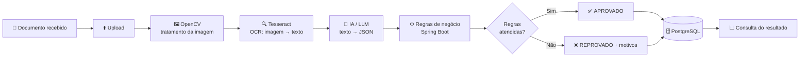

# 📄 Validação Inteligente de Documentos

> Da análise manual à automação com IA: uma solução que recebe documentos digitais, extrai informações com **OCR + Inteligência Artificial**, valida **regras de negócio** e disponibiliza o resultado de forma estruturada.

Projeto do semestre — **Mentoria Avanade 2026.2 · Recife · Residência Tecnológica**

## 📑 Sumário

1. [O problema](#1-o-problema)
2. [Usuário](#2-usuário)
3. [Documentos processados](#3-documentos-processados)
4. [Dados extraídos](#4-dados-extraídos)
5. [Regras de validação](#5-regras-de-validação)
6. [Aprovação](#6-aprovação)
7. [Rejeição](#7-rejeição)
8. [Fluxo da solução](#8-fluxo-da-solução)
9. [MVP](#9-mvp)
10. [Arquitetura e tecnologias](#10-arquitetura-e-tecnologias)
11. [Como a IA devolve o JSON](#11-como-a-ia-devolve-o-json)
12. [API REST](#12-api-rest)
13. [Banco de dados](#13-banco-de-dados)
14. [Estrutura do projeto](#14-estrutura-do-projeto)
15. [Como executar](#15-como-executar)
16. [Testes](#16-testes)
17. [Entregas do semestre](#17-entregas-do-semestre)

---

## 1. O problema

**Qual problema estamos resolvendo?**

Empresas gastam muito tempo validando manualmente documentos (comprovantes, formulários, contratos). Isso gera:

- ⏱️ **Atrasos** no cadastro e no atendimento;
- 🔁 **Retrabalho** por erros de digitação e conferência;
- ⚠️ **Riscos operacionais** (documento vencido, de outra pessoa ou ilegível aprovado por engano).

**Nossa proposta:** automatizar esse processo. O usuário envia o documento, o sistema lê, interpreta, valida as regras e devolve **Aprovado** ou **Reprovado** com os motivos.

---

## 2. Usuário

**Quem usaria essa solução?**

| Perfil | Como usa |
|---|---|
| **Analista de cadastro / Backoffice** _(principal)_ | Envia o documento do cliente e consulta o resultado da validação |
| Setor financeiro / RH _(secundário)_ | Conferência de comprovantes de renda e residência em admissões e concessões de crédito |

---

## 3. Documentos processados

**Quais documentos serão processados?**

| Documento | Papel no projeto |
|---|---|
| 🏠 **Comprovante de residência** | **Documento do MVP** (implementado primeiro) |
| 🪪 **Documento de identificação (RG/CNH)** | Segundo documento (evolução) |

> Exemplos aceitos de comprovante de residência: conta de água, luz, telefone e fatura de cartão.
> Formatos de entrada: **PDF, PNG, JPG** (máx. **10 MB**).

---

## 4. Dados extraídos

**Quais informações precisamos extrair?**

### Comprovante de residência

| Campo | Exemplo | Obrigatório |
|---|---|:---:|
| `nome` | Pedro Barbosa| ✅ |
| `cpf` | 529.982.247-25 | ⬜ (quando constar) |
| `endereco` |  Cais do Apolo, 925 | ✅ |
| `cep` | 50030-903 | ✅ |
| `cidade` / `estado` | Recife / PE | ✅ |
| `dataEmissao` | 2026-08-10 | ✅ |

### RG/CNH _(evolução)_

`nome`, `cpf`, `numeroDocumento`, `dataNascimento`, `dataValidade` (CNH).

---

## 5. Regras de validação

**Quais regras precisamos validar?**

| # | Regra | Como é verificada |
|---|---|---|
| R1 | **Documento legível** | OCR retornou texto suficiente e a IA conseguiu extrair campos |
| R2 | **Nome identificado** | Campo `nome` presente e não vazio |
| R3 | **Endereço identificado** | Campos `endereco` e `cep` presentes |
| R4 | **Emissão recente** | `dataEmissao` com **menos de 90 dias** (≈ 3 meses) |
| R5 | **Formato dos dados** | CPF e CEP em formato válido (regex / dígitos verificadores) |
| R6 | **Tipo correto** | O conteúdo corresponde ao tipo selecionado pelo usuário |

---

## 6. Aprovação

**O que faz o documento ser aprovado?**

✅ **Todos os dados obrigatórios foram extraídos e todas as regras (R1–R6) foram atendidas.**

Resultado: status `APROVADO`, dados salvos no banco e disponíveis para consulta.

---

## 7. Rejeição

**O que faz o documento ser rejeitado?**

❌ Qualquer um destes casos:

- Documento **ilegível** (baixa qualidade, cortado, com sombras);
- **Dados obrigatórios ausentes** (sem nome, endereço ou data);
- **Emissão há mais de 90 dias**;
- Tipo de documento **diferente** do selecionado.

Resultado: status `REPROVADO` com a **lista de motivos**, para o usuário corrigir e reenviar.

---

## 8. Fluxo da solução




**Etapas da tela (front-end):**

1. **Upload** — envio do documento
2. **Processamento** — OCR e extração
3. **Validação** — regras de negócio
4. **Resultado** — aprovado ou reprovado

---

## 9. MVP

**Qual é a menor solução que conseguimos construir e demonstrar no final do semestre?**

> Processar **1 tipo de documento (comprovante de residência)** com validação básica e consulta do resultado.

**Escopo do MVP**

- [x] Upload de PDF/imagem
- [x] OCR com Tesseract
- [x] Extração de campos com IA (JSON)
- [x] Regras: legível, nome, endereço, emissão < 90 dias
- [x] Persistência (H2 por padrão, PostgreSQL com perfil `postgres`)
- [x] Endpoint para consultar o resultado
- [ ] Tratamento de imagem com OpenCV _(desejável)_
- [ ] Segundo documento (RG/CNH) _(evolução)_
- [x] Tela web de upload, resultado e histórico
- [ ] Autenticação de usuários _(evolução)_

---

## 10. Arquitetura e tecnologias

Cada etapa tem um papel claro: **preparar → ler → interpretar → validar → persistir**.


| Etapa | Tecnologia | O que faz |
|---|---|---|
| Preparar | **OpenCV** | Remove ruído, corrige rotação, ajusta contraste, converte para P&B |
| Ler | **Tesseract (OCR)** | Reconhece caracteres e devolve uma `String` (não entende o significado) |
| Interpretar | **IA (LLM)** — OpenAI, Gemini, Claude ou AWS Bedrock | Transforma o texto em **JSON estruturado** |
| Validar | **Java + Spring Boot** | Converte o JSON em objeto, aplica regras e decide aprovado/reprovado |
| Persistir | **PostgreSQL** + **API REST** | Salva e disponibiliza o resultado |

### Tecnologias ao longo da mentoria

| Tópico | Aplicação no projeto |
|---|---|
| **Git** | Organização do time e versionamento |
| **Backend** | Estrutura da aplicação |
| **REST** | Endpoints da API |
| **Banco de dados** | Armazenar documentos e resultados |
| **Upload** | Receber arquivos (PDF/imagem) |
| **OCR** | Transformar documento em texto |
| **IA** | Transformar texto em informação estruturada |
| **Regras de negócio** | Validar e decidir aprovado/reprovado |
| **Testes** | Garantir que as regras funcionem |
| **Deploy** | Colocar a solução online |

### 💡 E se eu não quiser usar IA?

Dá para extrair com **palavras-chave + Regex** no Java:

```java
Pattern cpfPattern = Pattern.compile("\\d{3}\\.\\d{3}\\.\\d{3}-\\d{2}");
Matcher matcher = cpfPattern.matcher(texto);
if (matcher.find()) {
    String cpf = matcher.group();
}
```

Funciona bem para poucos tipos de documento e layouts previsíveis. Com muitos formatos diferentes, a IA é mais flexível.

### 🔀 Alternativa: IA multimodal

Alguns modelos (ex.: Gemini) recebem a **imagem direto**, sem Tesseract: `Imagem → IA multimodal → JSON`. Tem menos etapas, mas para **fins didáticos** o fluxo OpenCV + Tesseract + IA mostra claramente o papel de cada tecnologia.

---

## 11. Como a IA devolve o JSON

Enviamos o texto extraído pelo Tesseract junto com um **prompt** que instrui a IA a responder apenas com JSON.

**Prompt:**

```text
Extraia as informações do documento abaixo.
Retorne apenas os campos: nome, cpf, endereco, cep, cidade, estado e dataEmissao.
Se não encontrar um campo, retorne null. Não invente informações.
Responda somente com JSON válido.

TEXTO:
{{textoTesseract}}
```

**Resposta esperada:**

```json
{
  "nome": "João da Silva",
  "cpf": "52998224725",
  "endereco": "Rua das Flores, 150",
  "cep": "50000000",
  "cidade": "Guanambi",
  "estado": "BA",
  "dataEmissao": "2026-08-10"
}
```

**Objeto Java que recebe o JSON:**

```java
public record DadosDocumento(
    String nome,
    String cpf,
    String endereco,
    String cep,
    String cidade,
    String estado,
    LocalDate dataEmissao
) {}
```

**Exemplo de regra de negócio (emissão < 90 dias):**

```java
boolean emissaoRecente = dados.dataEmissao() != null
    && ChronoUnit.DAYS.between(dados.dataEmissao(), LocalDate.now()) < 90;
```

---

## 12. API REST

| Método | Endpoint | Descrição |
|---|---|---|
| `POST` | `/api/validacoes` | Upload do documento (`multipart/form-data`: `tipo`, `arquivo`) |
| `GET` | `/api/validacoes/{id}` | Consulta o resultado de uma validação |
| `GET` | `/api/validacoes` | Lista os envios (histórico) |

**Exemplo de resposta aprovada (`201 Created`):**

```json
{
  "id": 1,
  "tipo": "COMPROVANTE_RESIDENCIA",
  "nomeArquivo": "comprovante_residencia.pdf",
  "status": "APROVADO",
  "motivos": [],
  "dados": {
    "nome": "João da Silva",
    "cpf": "529.982.247-25",
    "endereco": "Rua das Flores, 150",
    "cep": "46430-000",
    "cidade": "Guanambi",
    "estado": "BA",
    "dataEmissao": "2026-08-10"
  },
  "criadoEm": "2026-10-27T18:30:00"
}
```

**Exemplo reprovado:**

```json
{
  "id": 2,
  "status": "REPROVADO",
  "motivos": ["Emissão há mais de 90 dias.", "Endereço não identificado."]
}
```

---

## 13. Banco de dados

O projeto usa **Spring Data JPA**: as tabelas são criadas automaticamente a partir da entidade `Validacao`.

| Tabela | Conteúdo |
|---|---|
| `validacao` | Tipo, arquivo, status, texto do OCR, dados extraídos e data |
| `validacao_motivo` | Motivos de reprovação (uma linha por motivo) |

- **Padrão:** H2 em memória (zero configuração; os dados somem ao reiniciar).
- **PostgreSQL:** `docker compose up -d` e rodar com `--spring.profiles.active=postgres`.

---

## 14. Estrutura do projeto

```text
validacao_inteligente_de_documentos/
├── README.md
├── pom.xml
├── docker-compose.yml                 # PostgreSQL
├── docs/imagens/                      # fluxo-solucao.svg, arquitetura.svg
└── src/
    ├── main/
    │   ├── java/br/com/mentoria/validacao/
    │   │   ├── ValidacaoInteligenteApplication.java
    │   │   ├── controller/ValidacaoController.java   # endpoints REST
    │   │   ├── service/
    │   │   │   ├── LeitorOcrService.java             # Tesseract / PDFBox
    │   │   │   ├── ExtratorIaService.java            # OpenAI ou Regex -> JSON
    │   │   │   ├── RegrasNegocioService.java         # regras R2 a R5
    │   │   │   └── ValidacaoService.java             # orquestra o fluxo (R1)
    │   │   ├── model/                                # entidade Validacao + enum
    │   │   ├── repository/ValidacaoRepository.java
    │   │   └── dto/                                  # DadosExtraidos, ResultadoDTO
    │   └── resources/
    │       ├── application.properties
    │       ├── application-postgres.properties
    │       └── static/index.html                     # tela web
    └── test/java/br/com/mentoria/validacao/service/           # testes das regras e da extração
```

---

## 15. Como executar

**Pré-requisitos:** Java 17+, Maven, Tesseract e (opcional) Docker e chave da OpenAI.

```bash
# 1. Clonar
git clone https://github.com/<usuario>/validacao_inteligente_de_documentos.git
cd validacao_inteligente_de_documentos

# 2. Instalar o Tesseract com o idioma português (Ubuntu/WSL)
sudo apt install tesseract-ocr tesseract-ocr-por

# 3. (Opcional) chave da IA. Sem ela, o sistema usa Regex.
export OPENAI_API_KEY="sua-chave-aqui"

# 4. Rodar
mvn spring-boot:run
```

**Tela web:** abra <http://localhost:8080> para enviar o comprovante e ver o resultado.

**Pela API:**

```bash
curl -X POST http://localhost:8080/api/validacoes \
  -F "tipo=COMPROVANTE_RESIDENCIA" \
  -F "arquivo=@comprovante_residencia.pdf"
```

> ⚠️ **Nunca** suba a chave de API para o GitHub. Use variável de ambiente e mantenha `.env` no `.gitignore`.

---

## 16. Testes

Os testes garantem que as regras funcionam, principalmente os casos de borda:

| Cenário | Resultado esperado |
|---|---|
| Documento completo, emitido há 10 dias | `APROVADO` |
| Emissão há 120 dias | `REPROVADO` |
| Sem endereço | `REPROVADO` |
| Texto do OCR vazio (ilegível) | `REPROVADO` |
| Emissão exatamente há 90 dias | `REPROVADO` (regra é _menos de_ 90) |

```bash
mvn test
```
---

## 🎯 Benefícios do projeto

- Ensina na prática o uso de diferentes tecnologias;
- Mostra o papel de cada etapa (preparar, ler, interpretar, validar, persistir);
- Desenvolve habilidades de integração com APIs e IA;
- Pode ser iniciado sem custos (Tesseract + OpenCV);
- Evolui para soluções mais robustas no futuro.

---

_"Tecnologia com propósito transforma realidades."_ — **Avanade · Juntos criamos o extraordinário**
